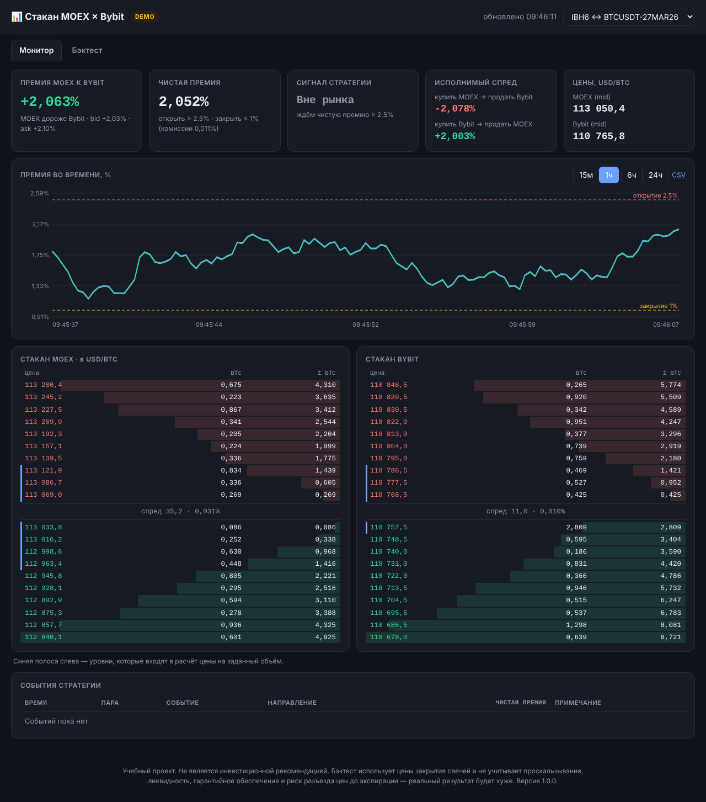
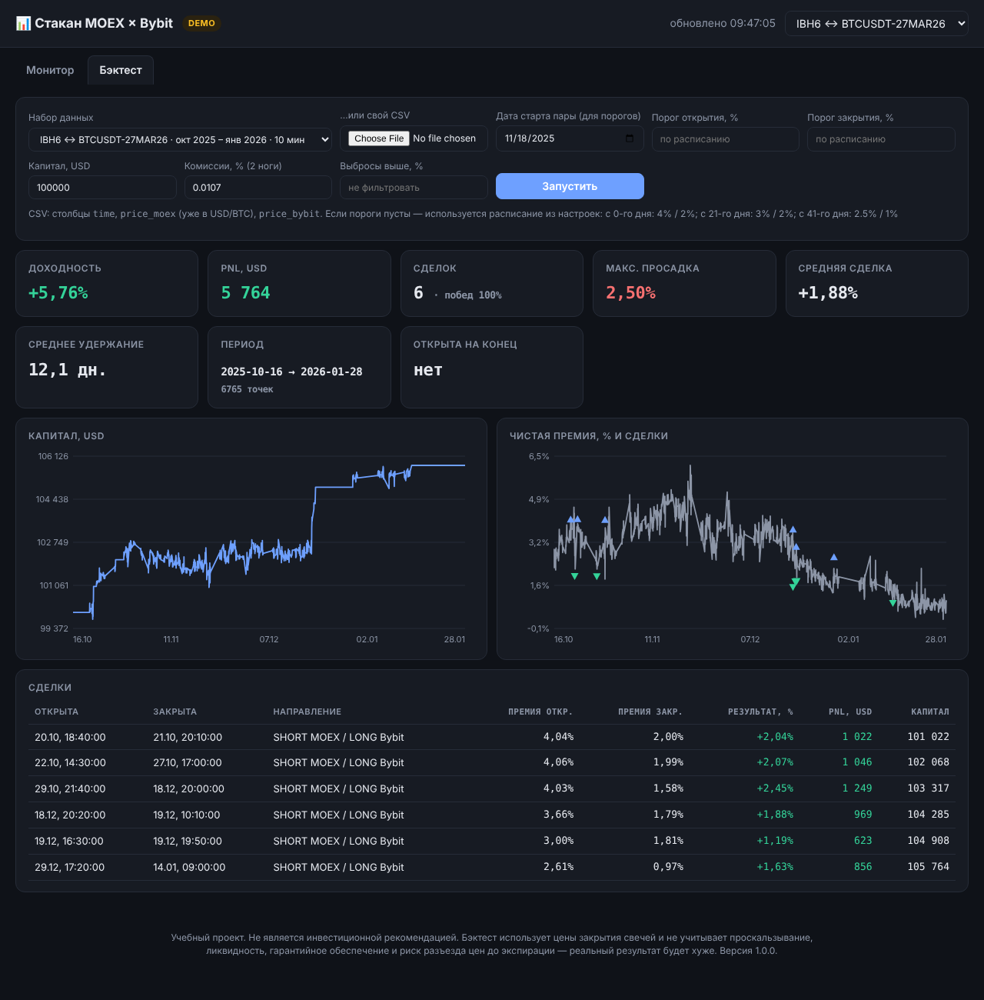

# 📊 stakanmoex

Мониторинг и бэктест арбитража **биткоин-фьючерсов Мосбиржи ↔ Bybit**.

Фьючерсы на биткоин на MOEX (например, `IBH6` на IBIT и `BTF6`) торгуются с заметной премией к квартальным фьючерсам Bybit — по историческим данным из репозитория она колеблется от долей процента до нескольких процентов. Проект следит за стаканами обеих бирж, считает премию с учётом глубины и комиссий, подаёт сигналы «открыть / закрыть» по пороговой стратегии и позволяет проверить стратегию на истории.



## Возможности

- **Живой монитор**: стаканы MOEX и Bybit рядом (MOEX пересчитан в USD/BTC), премия, чистая премия, исполнимый спред в обе стороны, график премии с порогами.
- **Сигналы стратегии**: автомат «вне рынка ⇄ в позиции» с порогами открытия и закрытия; пороги сужаются по мере приближения экспирации (`4/2 → 3/2 → 2.5/1 %`, настраивается).
- **Расчёт по глубине стакана**: цена считается как средневзвешенная на заданный объём (`size_btc`), а не по лучшей заявке; если глубины не хватает — интерфейс предупреждает.
- **Бэктест**: на встроенных исторических данных, на своём CSV или на свежей истории с бирж; график капитала, сделки, просадка, фильтр выбросов.
- **История в SQLite** + выгрузка в CSV.
- **Демо-режим без ключей**: синтетические стаканы, чтобы сразу увидеть интерфейс.
- Тёмная/светлая тема, адаптивная вёрстка, ноль внешних зависимостей во фронтенде.



## Быстрый старт

```bash
git clone https://github.com/artnik123/stakanmoex && cd stakanmoex
python -m venv .venv && source .venv/bin/activate     # Windows: .venv\Scripts\activate
pip install -r requirements.txt
python -m stakanmoex
```

Откройте http://127.0.0.1:8000. Без настроек запускается **демо-режим** (значок `DEMO` в шапке). Бэктест на встроенных данных работает сразу, токены ему не нужны.

### Живые данные

```bash
cp .env.example .env      # впишите MOEX_TOKEN
python -m stakanmoex
```

- **Bybit**: публичный стакан читается **без API-ключей** — ключи проекту не нужны вообще.
- **MOEX**: стакан в реальном времени требует токен [MOEX Algopack](https://data.moex.com/) (`MOEX_TOKEN`).

> ⚠️ **Проверьте тикеры в `config/pairs.json`.** Контракты `IBH6`/`BTF6` и `BTCUSDT-27MAR26` — мартовские 2026 года и уже экспирировались. Для текущих контрактов поменяйте `moex_ticker` и `bybit_symbol`. Коды месяцев на MOEX: `H` — март, `M` — июнь, `U` — сентябрь, `Z` — декабрь.

### Docker

```bash
docker compose up --build
```

## Как это считается

Для пары «фьючерс MOEX ↔ фьючерс Bybit»:

1. Стаканы приводятся к одним единицам: цена MOEX × `moex_multiplier` = USD за 1 BTC; лоты MOEX / `moex_lots_per_btc` = BTC.
2. По каждой стороне считается средневзвешенная цена на `size_btc`.
3. `bid_basis` и `ask_basis` — разница bid-с-bid и ask-с-ask в % от меньшей цены (это `procb`/`procs` из исходных скриптов). Их среднее — **премия**.
4. **Чистая премия** = |премия| − комиссии (`BYBIT_FEE + MOEX_FEE`). Именно она сравнивается с порогами.
5. Дополнительно показывается **исполнимый спред** — чистый результат мгновенной пары сделок (купить на одной бирже по ask, продать на другой по bid).

Стратегия — это сходимость базиса: при чистой премии выше порога открытия — продать дорогую биржу и купить дешёвую, при падении ниже порога закрытия — закрыть обе ноги. Прибыль сделки в бэктесте ≈ `(премия при открытии − премия при закрытии) × рабочая часть капитала`; капитал делится 50/50 и выравнивается после каждой закрытой сделки (как в исходном `test.py`).

**Про `moex_multiplier` у `IBH6`.** Фьючерс котируется в акциях IBIT, поэтому цена умножается на число акций на 1 BTC (`shares_outstanding / BTC в фонде`, у автора это `1369760000 / 777722.8`). Эти числа со временем меняются — периодически обновляйте множитель по данным iShares. Для `BTF6` цена уже в USD/BTC, множитель 1; **проверьте `moex_lots_per_btc` по спецификации контракта.**

## Настройки

Всё задаётся в `.env` (см. `.env.example`) и `config/pairs.json`.

| Переменная | По умолчанию | Описание |
|---|---|---|
| `DATA_MODE` | `auto` | `auto` — live при наличии `MOEX_TOKEN`, иначе demo; можно задать `demo`/`live` |
| `MOEX_TOKEN` | — | токен MOEX Algopack |
| `POLL_INTERVAL` | `2` | период опроса, сек |
| `STORE_EVERY` | `5` | как часто писать точку в SQLite, сек |
| `RETENTION_DAYS` | `30` | срок хранения истории |
| `BYBIT_FEE`, `MOEX_FEE` | `0.0001`, `0.0000066` | комиссии за ногу, доля от цены |
| `THRESHOLDS` | `0:4:2,21:3:2,41:2.5:1` | `день:открыть%:закрыть%` — этапы порогов |
| `STRATEGY_START_DATE` | `2025-11-18` | точка отсчёта «возраста» пары (можно задать `start_date` у каждой пары) |
| `HOST`, `PORT` | `127.0.0.1`, `8000` | адрес веб-сервера |
| `DB_PATH` | `data/stakanmoex.db` | файл SQLite |

Поля пары в `config/pairs.json`: `moex_ticker`, `bybit_symbol`, `bybit_category` (`inverse` как в исходном коде; для USDT-контрактов может понадобиться `linear` — проверьте на Bybit), `moex_multiplier`, `moex_lots_per_btc`, `size_btc`, `start_date`.

## Командная строка

```bash
python -m stakanmoex                       # веб-интерфейс
python -m stakanmoex backtest --dataset pair2 --open-pct 3 --close-pct 1
python -m stakanmoex backtest --csv my.csv --open-pct 2.5 --close-pct 1   # столбцы: time, price_moex, price_bybit
python -m stakanmoex history --pair btf6 --days 30 --out data/btf6.csv    # свежая история с бирж (нужен MOEX_TOKEN)
```

## HTTP API

| Метод | Путь | Что отдаёт |
|---|---|---|
| GET | `/api/state` | текущие метрики, стаканы, позиция по каждой паре |
| GET | `/api/history/<pair>?minutes=60` | история премии |
| GET | `/api/events` | последние сигналы open/close |
| GET | `/api/export/<pair>.csv` | все сохранённые тики |
| POST | `/api/backtest` | бэктест (JSON или multipart с CSV) |
| GET | `/healthz` | проверка живости |

## Структура

```
stakanmoex/
  config.py, models.py     настройки, структуры данных
  orderbook.py             разбор стаканов, VWAP на объём
  spread.py                премия, чистая премия, исполнимый спред
  signals.py               пороги и автомат сигналов
  backtest.py, history.py  бэктест и сборка истории
  storage.py, monitor.py   SQLite и фоновый опрос
  providers/               bybit, moex (moexalgo), live, demo
  web/                     Flask-приложение и интерфейс
config/pairs.json          список пар
data/samples/              исторические данные для бэктеста
tests/                     unittest (45 тестов, без сети)
```

Тесты: `python -m unittest discover -s tests -t .`

## Ограничения — читайте перед выводами

- **Бэктест оптимистичен.** Он использует цены закрытия свечей и не учитывает проскальзывание, глубину рынка, гарантийное обеспечение, ставки финансирования и риск того, что премия вырастет против позиции до экспирации. 100% прибыльных сделок на встроенных данных — повод для осторожности, а не для радости.
- **В исторических данных есть выбросы** (одиночные свечи с «премией» 18% на неликвидном контракте). Один такой выброс на паре `BTF6` меняет доходность с 5% до 14,5% — используйте поле «Выбросы выше, %».
- Проект **не торгует**, только считает и сигнализирует.
- Модули live-провайдеров (`moex.py`, `bybit.py`) покрыты разбором данных, но их связь с реальными API в тестах не проверялась — тесты работают без сети.
- Не является инвестиционной рекомендацией.
